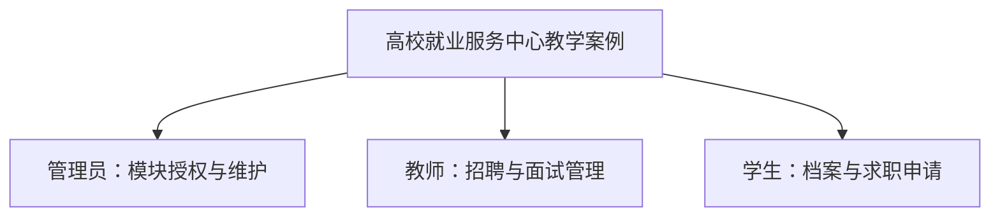
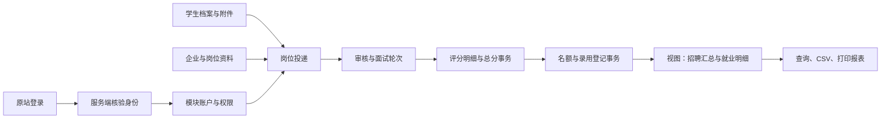
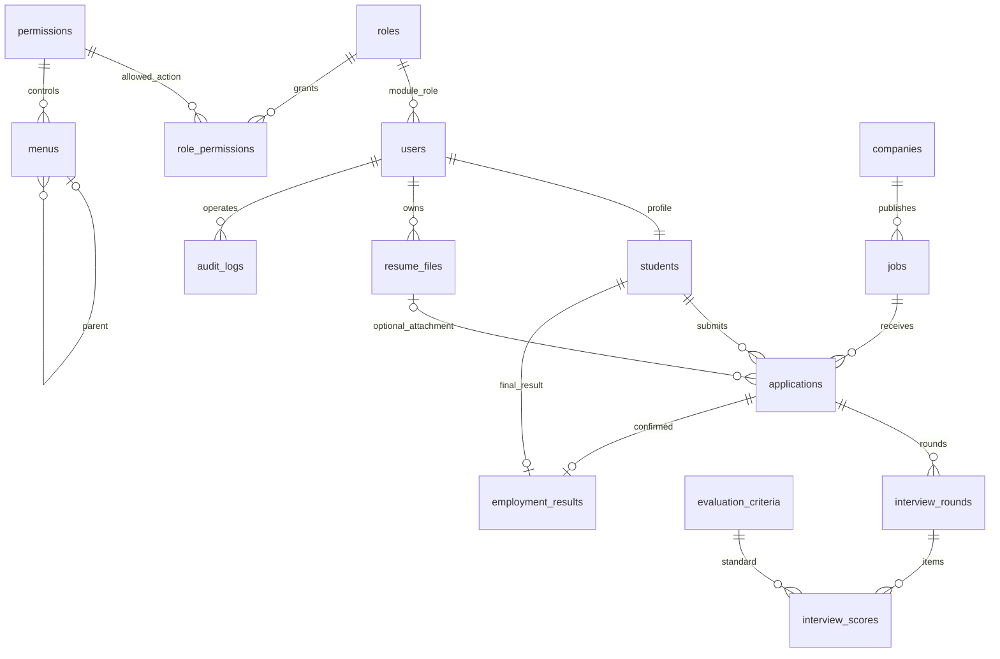

# 组织、业务、数据流和 ER 图

## 组织职能

## 业务与数据流

## 全局 ER 图

## 概念设计说明

学生与岗位通过 applications 建立多对多关系；面试轮次与评分明细拆表展示主从结构。录用同时关联申请及其学生，并用组合外键确保两者一致。模块 users 只映射原站账户，不包含密码；模块教师身份不改变原站 USER 身份。

局部授权分图由 roles、permissions、role_permissions、menus 和 users 组成；局部招聘分图由 students、companies、jobs、applications、interview_rounds、evaluation_criteria、interview_scores、employment_results 和 resume_files 组成。两图通过 users 合并，audit_logs 记录跨模块操作。
